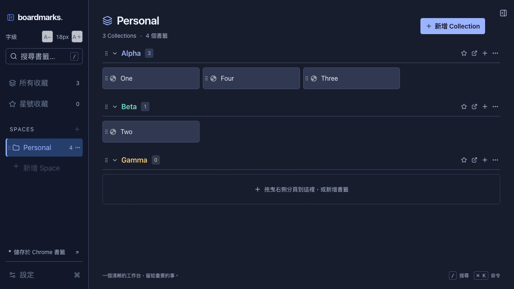

# Boardmarks — 書籤工作台

**把散落的分頁，整理成隨時能接續工作的書籤空間。**

Boardmarks 是以 Chrome 原生書籤為基礎的新分頁擴充功能，將工作空間、分類收藏與目前開啟的分頁整合在同一個畫面。透過拖曳、搜尋與整個視窗收藏，你可以把臨時找到的資料整理成可重複使用的工作資源，減少反覆找網址、切換視窗與重新建立資料清單的時間。

採用繁體中文介面，支援 macOS / Windows Chrome。無須註冊 Boardmarks 帳號或架設後端，網址與分類直接保留在 Chrome 書籤中；即使移除外掛，這些書籤仍然存在。

**目前版本：1.0.10** · Chrome 120+ · Manifest V3 · [安裝指南](docs/INSTALL.md) · [更新紀錄](CHANGELOG.md)



_上圖為 1.0.9 的示範資料畫面；1.0.10 延續此介面，並加入左右清單整列拖曳。_

## 為什麼使用 Boardmarks？

### 讓工作資料有脈絡，切換任務更容易

用 **Space（工作空間）** 區分工作、學習或個人事務，再用 **Collection（分類）** 整理專案、主題與常用工具。開啟新分頁就能看到目前工作需要的連結，減少在長串書籤和多個視窗之間來回尋找。研究資料、專案文件與參考網站可以依用途集中，日後回到同一個任務時，更容易接續原有工作。

### 隨手收藏正在看的內容，降低整理負擔

右側直接顯示開啟中的視窗與分頁，拖入分類即可收藏，不必逐一複製貼上網址。也能把整個視窗的可收藏網址加入既有或新分類，適合在研究告一段落、會議結束或切換專案時保留相關資料。一般拖曳會保留原分頁；需要收起分頁時，可使用「收藏並關閉」，先確認收藏成功才關閉，幫助你減少畫面雜亂。

### 保留資料自主性，降低日後搬家的成本

網址與資料夾使用 Chrome 原生書籤儲存，可透過 Chrome 書籤管理員繼續管理，毋須依賴 Boardmarks 的專屬雲端服務。另提供 JSON 匯出與預覽匯入，方便保留備份、搬移收藏或在整理前留下資料副本。移除外掛不會連帶刪除已存入 Chrome 的書籤，讓長期累積的收藏更容易延續使用。

### 減少跨裝置重複整理

在 Mac 與 Windows 上使用相同 Chrome 帳號並啟用書籤同步後，可透過 Chrome 同步網址和分類。主題、欄寬、星號與摺疊等偏好則使用 Chrome 的擴充功能同步儲存，讓不同裝置更容易維持熟悉的工作方式。同步仍取決於 Chrome 設定、相同的擴充功能 ID 與帳號環境，並非 Boardmarks 自建的即時同步服務。

### 注重隱私，也降低部署與維護負擔

Boardmarks 不要求額外會員、不上傳網址至 Boardmarks 伺服器，也不載入分析追蹤、遠端程式或第三方字型。網站圖示取自 Chrome，不將收藏網址交給第三方圖示服務。建置後即可在瀏覽器內執行，日常使用不需要 Node.js 或後端服務，個人使用與自行維護都更單純。

### 讓長時間使用更舒適，操作更順手

深色、淺色與跟隨系統主題可配合不同環境；中央工作區、左側導覽與右側分頁可分別調整字級。欄寬、密度與側欄收合則幫助你在不同螢幕尺寸下分配空間。全域搜尋、命令選單與鍵盤拖曳操作，讓習慣鍵盤或需要較大文字的使用者，都能選擇適合自己的整理方式。

### 整理時有確認與復原，減少誤操作的影響

刪除非空分類或工作空間前會顯示內容數量，刪除與移動後提供 5 秒復原。匯入先驗證內容並顯示預覽，確認後新增工作空間，不覆蓋既有收藏；收藏並關閉也會檢查原分頁是否已換網址。這些操作保護有助於降低整理時的失誤成本，詳細範圍與限制見下方「資料安全與限制」。

## 功能與實際好處

| 功能                         | 可以幫你做什麼                                                           |
| ---------------------------- | ------------------------------------------------------------------------ |
| Space / Collection 分層整理  | 將不同專案與生活主題分開，回到任務時更容易找到相關資源。                 |
| Space、分類與書籤拖曳排序    | 按實際工作順序調整位置，常用資料可放在容易找到的地方。                   |
| 分頁拖曳收藏、整個視窗收藏   | 把瀏覽中的資料集中保存，減少逐筆建立書籤的重複操作。                     |
| 收藏並關閉                   | 確認網址已保存後再收起分頁，減少同時開啟太多分頁的負擔。                 |
| 全域搜尋、星號收藏、命令選單 | 透過關鍵字與常用標記縮短找資料和執行操作的步驟。                         |
| Chrome 原生書籤與同步        | 沿用瀏覽器的書籤管理方式，配合同步設定在不同裝置延續收藏。               |
| JSON 備份、預覽與追加匯入    | 先確認匯入內容，再加入既有工作台，方便備份及搬移資料。                   |
| Toby JSON v3 匯入            | 保留可匯入的分類順序、書籤名稱與網址，減少轉換工具時手動重建收藏的工作。 |
| 主題、獨立字級、密度與欄寬   | 依螢幕大小及閱讀需求調整介面，讓常用內容更容易閱讀。                     |
| 刪除確認、移動與刪除復原     | 整理前知道影響範圍，誤操作後可在限定時間內復原。                         |

## 適合哪些使用情境？

- **專案工作與接案：** 每個專案建立一個 Space，將需求文件、設計稿、管理工具與參考網站分成不同 Collection。
- **研究與學習：** 依課程、研究問題或主題收集資料，結束一輪瀏覽時保存整個視窗的網址，方便下次繼續查閱。
- **日常多工：** 將待閱讀、常用服務與個人規劃集中整理，讓新分頁成為固定的工作入口。
- **從 Toby 搬移收藏：** 匯入 JSON v3 中可支援的網址與分類，減少手動搬移。筆記、說明與標籤等限制會在預覽中提示。

Boardmarks 保存的是書籤名稱、網址與分類，不會備份網頁內容、登入狀態或未送出的表單；整理過的連結仍須由原網站提供內容。

## 安裝已建置版本

1. 將安裝包內 `Boardmarks` 的內容複製到固定位置：Windows `%LOCALAPPDATA%\Boardmarks\extension`；Mac `~/Library/Application Support/Boardmarks/extension`。
2. 開啟 `chrome://extensions`，開啟「開發人員模式」。
3. 點擊「載入未封裝項目」，選擇上述直接含 `manifest.json` 的 **extension** 資料夾。
4. 開啟新分頁，接受 Chrome 的新分頁變更提示（如有）。
5. 點擊「建立我的工作區」，建立 `Boardmarks / Personal / Favorites`。

從原始碼執行 `npm run build` 後，開發時可直接載入專案內的 `dist` 資料夾；日常使用建議複製到固定位置。Windows 使用相同內容即可，路徑可不同。這是可側載的外掛，尚未上架 Chrome Web Store。

載入後必須保留安裝資料夾；ZIP 可以刪除。更新時覆蓋同一資料夾的程式檔案，再按「重新載入」，不需要移除外掛。完整步驟見 [安裝、搬移與更新](docs/INSTALL.md)。

## 使用

- Space 是工作空間，Collection 是其中的書籤資料夾。
- 左側新增 Space；中央新增 Collection；Collection 右側 `+` 新增網址。
- 按住 Space 列、Collection 標題或書籤卡片可直接拖曳排序；書籤也能跨 Collection 移動。拖曳到 Space 可切換工作空間，放開時可選 Collection。
- 按住右側分頁的名稱、圖示或列內空白處，拖入 Collection 即可收藏，原分頁保留。
- 分頁選單支援「收藏並關閉」；先確認儲存成功，且原分頁尚未換網址，才關閉。
- 視窗標題右側 `+` 收藏整個視窗，可選既有或新 Collection；略過重複及 Chrome 內部頁面。
- 書籤單擊在目前視窗開新分頁；Ctrl / Cmd + Click 或中鍵於背景開啟。
- 右鍵或 `…` 提供編輯、移動、複製網址、刪除等操作。
- `／`（半形 `/`）搜尋；`Ctrl / Cmd + K` 開啟命令選單；Esc 關閉對話框；拖曳把手可用 Space 與方向鍵操作。
- 聚焦書籤時 Delete 會先詢問確認。非空 Collection / Space 刪除會顯示內容數量；刪除及移動提供 5 秒復原。
- 設定提供 System / Dark / Light、字體大小（14／16／18px，預設 16px）、密度、欄寬、開啟行為、JSON 匯出與預覽匯入。
- 字體大小位於「設定 → 外觀」，附即時樣本預覽；按「儲存設定」套用。緊湊模式保留所選字級。
- 左側側欄預設 18px，可在「左側側欄字體」選擇 16／18／20／22px 或跟隨整體；左上 A−／A＋直接調整並保存，包含搜尋、導覽、Space 名稱及新增／設定按鈕。
- 右側分頁預設 18px，可在「右側分頁字體」選擇 16／18／20／22px 或跟隨整體；面板頂端 A−／A＋可直接調整並保存。視窗標題、說明與圖示一起調整。
- 設定視窗底部顯示目前版本，更新後可確認為 Boardmarks v1.0.10。
- 欄位分隔線也可拖曳調整寬度；聚焦分隔線後按左右鍵可微調。

## 同步與隱私

- 網址與資料夾由 **Chrome 書籤同步**處理。兩台裝置需登入相同 Chrome 帳號並啟用書籤同步。
- 主題、欄寬、星號與摺疊使用 `chrome.storage.sync`。兩台裝置需安裝相同版本外掛、啟用擴充功能同步；企業政策也可能限制同步。
- `manifest.json` 包含固定的公開 key，確保不同解壓縮路徑／作業系統仍取得同一個開發版 extension ID；不包含私鑰。正式上架時應改用商店核發的公開 key，先規劃設定轉移。
- 不要求外掛會員或自建同步服務。Chrome 自身的同步是使用者選擇的瀏覽器功能。
- 權限僅 `bookmarks`、`tabs`、`storage`、`favicon`。不讀 history/cookies，不載入遠端程式、字型或分析工具，不上傳網址到 Boardmarks 伺服器。
- favicon 取自 Chrome 的 `_favicon`，失敗顯示地球圖示。不向第三方 favicon 服務傳送 URL。
- 支援 HTTP / HTTPS / FTP / file 收藏。Chrome 內部頁面、javascript/data URL 不會被建立或開啟。
- URL 重複比較只忽略路徑末尾斜線；保留 query 與 hash。

## 開發

建議 Node.js **22.13+ LTS 或 24+ LTS**，npm 11.20+。包含 package-lock.json。

```bash
npm install
npm run dev
npm run build
npm run test
npm run lint
```

需要安裝包時，執行下方的 `npm run package` 即可產生 `Boardmarks-v1.0.10.zip` 與 SHA-256 檢查檔。Git 儲存庫保存原始碼及文件，不納入本機安裝複本、建置產物或歷史 ZIP。

`npm run dev` 是獨立的瀏覽器開發預覽，頂端有明確標示。資料存放於該來源的 localStorage，分頁清單為示範資料；不會碰觸 Chrome 真實書籤。**真正的 API、同步及新分頁功能須載入 dist 測試。**

正式打包所有 JS/CSS 到 dist；沒有執行期 Node.js 或後端。原始 Manifest 位於 `public/manifest.json`，由 Vite 複製至 dist。

```bash
# 安裝 Playwright 測試用 Chromium（一次即可）
npx playwright install chromium
npm run build
npm run test:e2e
npm run test:preview

# 可選：產生 ZIP 與 SHA-256（需 Python 3）
npm run package

# 或指定既有測試用 Chromium
CHROMIUM_PATH=/path/to/Chromium npm run test:e2e
```

整合測試使用一次性的隔離設定檔，不會讀寫日常 Chrome 設定檔。macOS/Linux 設定 CHROMIUM_PATH 的方式如上；PowerShell 使用 `$env:CHROMIUM_PATH = 'C:\path\chrome.exe'`。新版品牌 Chrome 可能禁止命令列側載，自動化請使用 Playwright Chromium。

## 資料安全與限制

- 只寫入選定的 Boardmarks 根資料夾內。首次建立優先使用可同步的 Chrome 系統資料夾；未啟用同步時使用本機書籤。
- 若尚未綁定根目錄時發現多個同名 Boardmarks，會要求在 Chrome 書籤管理員重新命名多餘的根資料夾，避免選錯。
- 外部加入不符合三層結構的項目不會被刪除或重新整理成另一種結構，UI 提示在 Chrome 書籤管理員整理。此時會拒絕不完整的 JSON 匯出；可先用 Chrome 原生 HTML 備份。
- 書籤 ID 僅在單一 Chrome profile 有效；跨裝置 metadata 使用分類路徑與同名出現序號的 SHA-256 key。建議同層分類名稱保持唯一。本機 ID-path 索引會處理外部重新命名、同名重排、刪除清理與 Undo。不同裝置同時進行互相衝突的修改仍依 Chrome Sync 規則收斂，需實機驗收；網址本體仍由 Chrome 管理。
- 匯出會先重讀原生書籤並驗證備份可重新匯入。原生空白名稱、名稱前後空格與長標題保留。匯入只新增 Spaces，不覆蓋現有資料；提供數量預覽。匯入中途失敗時保留已寫入部分並明確報告，重試可能建立額外資料夾。外觀偏好包含於匯出，匯入預設保留目前偏好。
- 5 秒復原只在當前頁面存續；移除／重建書籤的復原會取得新的 Chrome ID。原父資料夾已消失時拒絕復原，不將資料放到錯誤位置。
- Chrome 無跨多個 API 的交易，也無跨裝置鎖；多端同時修改仍依 Chrome 規則處理。外掛內使用 Web Locks 序列化寫入、刪除前比對確認內容、寫入後重新讀取來源。
- 不能替使用者開啟 Chrome Sync，也不能保證同步到達時間。Mac ↔ Windows 帳號同步已由使用者整體驗收確認；自動化驗證不包含登入帳號的跨裝置同步。

架構與測試細節見 [ARCHITECTURE.md](ARCHITECTURE.md)、[TESTING.md](docs/TESTING.md)，工作進度見 [TODO.md](TODO.md)。2026-09-28 的使用者實機驗收對應 1.0.9；1.0.10 的本機回歸範圍另記於測試報告，驗收依據見 [DEVICE_ACCEPTANCE.md](docs/DEVICE_ACCEPTANCE.md)。

更新時請載入本次 `dist` 或 `Boardmarks-v1.0.10.zip` 解壓後的資料夾；工作目錄內先前自行解壓的 `Boardmarks` 舊版複本不會被程式覆寫。

跨 Mac／Windows 的逐步驗收與回報表見 [實機驗收](docs/DEVICE_ACCEPTANCE.md)。

矮視窗或較大的顯示縮放下，左側中段可整體捲動；搜尋快捷鍵會將搜尋框帶回可見範圍，底部設定保持可用。

### 從 Toby 匯入

設定 → 匯入 JSON，選擇 Toby 匯出的 JSON v3 檔案。預覽會列出分類與可匯入書籤數量；確認後新增「Toby 匯入」Space。分類、書籤順序、自訂名稱與網址會保留，既有資料不會覆蓋。

Toby 筆記卡片、不支援的網址、自訂說明與分類標籤無法存入目前的 Chrome 書籤模型，預覽會列出未匯入數量；請保留原始 Toby JSON。重複匯入會新增另一個 Space。

### 收合與排序

點左上角面板圖示可收合左側；窄工具列保留展開、搜尋與設定。收合狀態會保存，`/` 或命令選單搜尋會展開並聚焦搜尋框。

按住 Collection 標題拖曳可調整上下順序；按住書籤卡片拖曳可排序或移到其他 Collection。小幅移動不啟動拖曳，一般點擊仍可摺疊分類或開啟書籤。按 Esc 取消拖曳，也可聚焦拖曳把手，以空白鍵開始、方向鍵移動、空白鍵放下。
